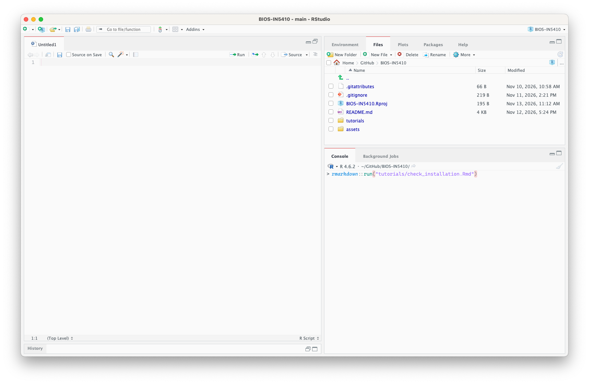
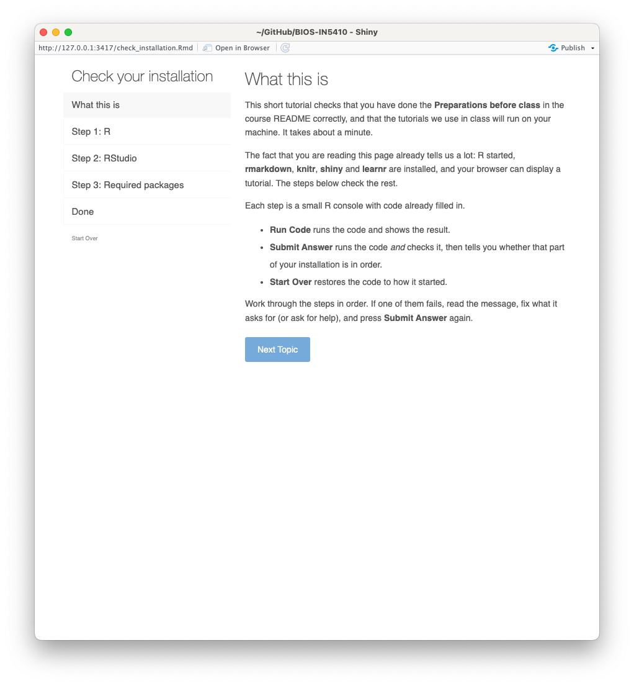

# BIOS-IN5410: Working with R 

> NB. I'm not going to stop you if you are curious, but the point of this repository is *not* to open, read, and "manually" interact with the files under `tutorials/`! Please follow the instructions below to show the student-facing content. The code files here are relatively complicated and you are most certainly not expected to understand them as part of the class. By all means ask how it works if you want to.

## Preparations before class
### 1. Readings
Prior experience with programming (in R or otherwise) is not a formal entry requirement in BIOS-IN5410 and we will cover the basics in our first session. However, the less prior experience you have, the more you will benefit from diligent self-study (and the more you will struggle without it). Before class on Friday 2026.11.13 we highly advise you read *all* of https://rstudio-education.github.io/hopr/index.html (skip chapters 8, 10, and 12). You should make an effort to understand this book *before* class. If you have programming experience but have never touched R, this book will get you up to speed with R syntax.

### 2. Software
You must install all necessary software before class. We will not be able to spend time on this in plenary but can help you if you have problems with a *personal* laptop. If your laptop is owned by your university, see [University-managed laptops](#university-managed-laptops).

#### University-managed laptops
If you have a university-managed laptop, you might be able to install R and RStudio through a managed software portal (e.g. 'Managed Software Centre' on a UiO Mac). If you have difficulties installing R and RStudio on a university-managed machine, **consult your IT department**.

#### 2.1 R
You must install R before class (see instructions at https://www.r-project.org/). The Norwegian mirror is hosted by UiB: https://cran.uib.no/.

#### 2.2 RStudio
We will work with R through an 'IDE': an 'Integrated Development Environment'. This is a text editor with features that are helpful for programming, such as syntax highlighting and a built-in file browser. The IDE we will use is a classic R IDE, and is called 'RStudio'. Again, please install it *before* class. See https://docs.posit.co/ide/user/download.html.

#### 2.3 Clone or download this repository
Clone this repository with git:
```sh
git clone https://github.com/ErikSRoeed/BIOS-IN5410
```
To update your local copy of the repository later, use git again:
```sh
git fetch --all
git pull
```
If you don't have git on your local computer, simply download and unzip the repository (the green download button).

#### 2.4 Install the required packages
Run this from the **R terminal inside RStudio**:
```R
install.packages(c("learnr", "rmarkdown", "shiny", "knitr", "tidyverse"))
```

#### 2.5 Check that everything works
Open the BIOS-IN5410.Rproj RStudio project from your file tree or from within RStudio. Once you have done this, run the test tutorial and make sure every step works. If so, you are good to go for class! To run the tutorial, type the following in the RStudio R terminal:
```R
rmarkdown::run("tutorials/check_installation.Rmd")
```
Or, for illustration:

This will open the tutorial in a new window:


## Summary of how to run the tutorials
1. Ensure you have the most recent version of this repository with `git pull`: [see here](#23-clone-or-download-this-repository)
2. Open the `BIOS-IN5410.Rproj` RStudio project: either by double clicking it in the file tree or with the project selector in the top right corner of RStudio (which says "Project: (None)" if you have no project open).
3. Launch the relevant tutorial with `rmarkdown::run("tutorials/<tutorial>.Rmd)`

## Friday 2026.11.13
### 14.15 - 17.00: Programming with R
Today you will follow a self-paced (informal!) test covering the basic grammar of programming: variables, output, functions, loops, and conditional logic. Launch it with `rmarkdown::run("tutorials/programming.Rmd")`.

## Resources and texts
This course is heavily inspired by the following resources:
- Garrett Grolemund, "Hands-On Programming With R" (https://rstudio-education.github.io/hopr/)
- Hadley Wickham, Mine Çetinkaya-Rundel, and Garrett Grolemund: "R for Data Science" 2nd ed. (https://r4ds.hadley.nz/)
- Claus O. Wilke: "Fundamentals of Data Visualization" (https://clauswilke.com/dataviz/)
