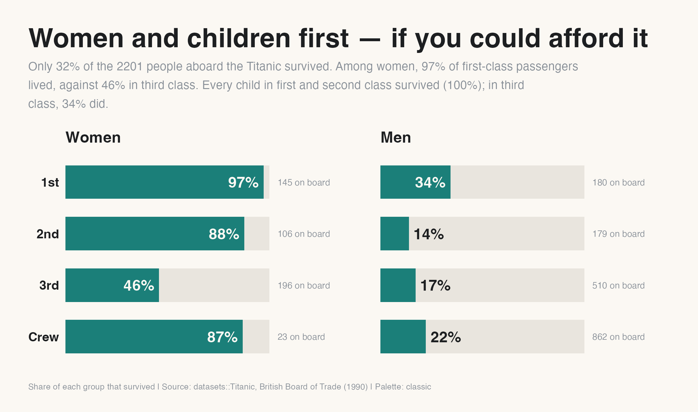
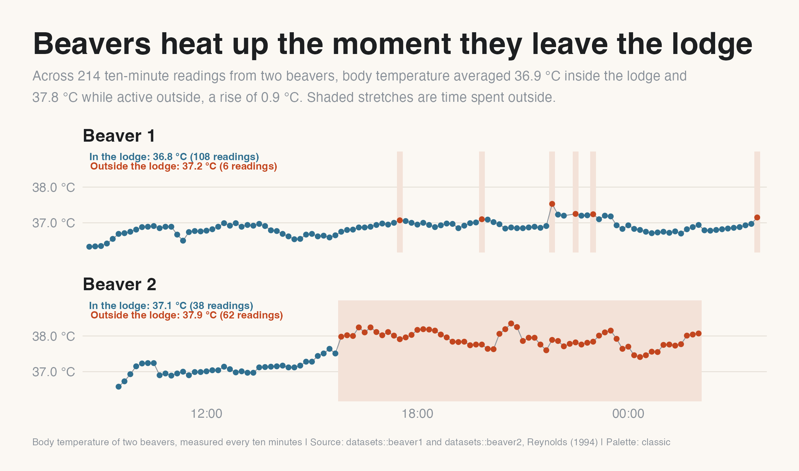

# _Actually_ working with R

So far we've practised the pieces separately: git and GitHub from RStudio, scripts that run as standalone programs on the terminal, and tidyverse for turning tables into visuals. Now you'll put them together on a realistic task. There are no step-by-step instructions here — if you forget how to set up an RStudio Project or a GitHub repo, refer to previous exercises, to a web search, to an LLM, etc...

## The goal

You are going to build an **infographic** from scratch. Conduct an end-to-end reproducible analysis in R: pick a **built-in R dataset**, pick **a meaningful question** about it, and write a script that answers it with an **infographic**. Then hand it to someone else and make sure they clone your repository and get a comparable result.

Here is a list of goals:

- [ ] A **new RStudio project** in a **new, public GitHub repository**.
- [ ] The analysis runs end-to-end with `Rscript` from the terminal, with no interactive steps.
- [ ] The only non-base-R package your can use is **tidyverse**, so that it transfers to anyone in the course.
- [ ] The script takes at least one command-line argument — a colour scheme, text size, output filename, whatever you like. Make the script stop with a useful message if the argument is missing or of the wrong type (this is something we've not done in class, but an LLM will do this for you easily).
- [ ] The script writes the infographic to a file, and that file is **committed to the repository**, so your peer has something to compare against.
- [ ] A comment at the top of the script says what each argument does and gives the **exact command that produced the committed image**, so that somebody else can repeat that run. The example scripts below start with such a comment — copy the idea.
- [ ] A peer has cloned the repository, run that command, and got the same output as you.

"The same output" means the same numbers and the same picture. Fonts and graphics devices differ between machines, so two correct runs can differ in small details of rendering.

## What is an infographic?

An infographic is a figure showing data, but not quite like a journal figure. You can check out the Wikipedia page about infographics [here ](https://en.wikipedia.org/wiki/Infographic)...

This is the kind of output you are aiming for, produced by [this script](../scripts/titanic_infographic.R) from the built-in `Titanic` dataset:



A second example, [this script](../scripts/beaver_infographic.R), does the same with `beaver1` and `beaver2`:



Both examples were written entirely by Claude Opus 5 through GitHub Copilot in Visual Studio Code. They are certainly not perfect, but give you an idea of what you can throw together quickly (and nitpick on later).

## What tools can you use?

Use anything you like: agents, chat LLMs, whatever. This task is a lot more complex than anything we have done so far, so let an LLM do some of the (in fact, a _lot_ of the) work for you — as long as you can make sense of what it does — and ask it for tweaks to the infographic in plain language once you begin to get results. The standard should be high because you have access to any tool: if something looks unappealing, fix it.

**One thing: a model asked for a "newspaper-style infographic" will try to use packages that do not exist in `tidyverse`. If you use an LLM, specifically tell it that it may use base R, `tidyverse`, and nothing else.**

## Pick a dataset, any(-ish) dataset

R ships with around a hundred example datasets in the always-available `datasets` package; the `iris` we have used is one of them. List them all, and read the help page of any one (which tells you what the rows and columns are and where the data came from), from the R Console:

```R
library(help = "datasets")
?mtcars
```

Datasets bundled with tidyverse packages (`ggplot2::diamonds`, `dplyr::starwars`) are fair game too, since you are allowed to load tidyverse anyway. Once one catches your eye, inspect it properly so you know what you are getting into:

```R
str(mtcars)
head(mtcars)
summary(mtcars)
dim(mtcars)
```

## Pick a question

Your choice. Raise a hand if you want suggestions. Something a newspaper would print as a headline works well for an infographic.

## Test it yourself, then hand it over

Before you ask a peer to try your script, clone your own repository to another directory and run it as if you had never seen it:

```sh
git clone git@github.com:YOUR-USERNAME/YOUR-REPOSITORY.git <another-directory>
cd <another-directory>
Rscript your_script.R your arguments here
```

Then **open the image the clone produced and compare it to the committed one**. Running without an error is not the same as reproducing: a script can run perfectly and draw something different. If something is wrong: figure out what, dix the cause, commit, and clone again.

When that works, swap repositories with somebody at your table. Give them the URL and nothing else — no explanations, no "you just have to ..." — because everything they need has to be in the repository, and that is exactly what you are testing. Ask them whether it ran without errors, whether their image matches yours, and whether anything in the script's comment was missing, wrong or unclear. Then do the same for them.

When every box in [the list above](#the-goal) is ticked, you are done — and you are equipped to run reproducible analyses in R on your own.
