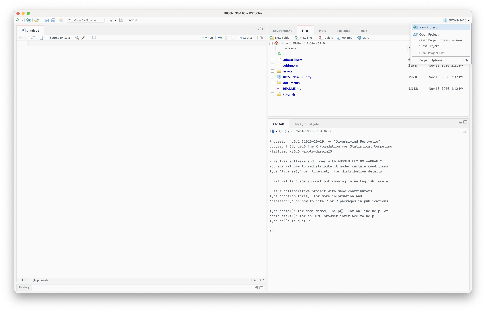
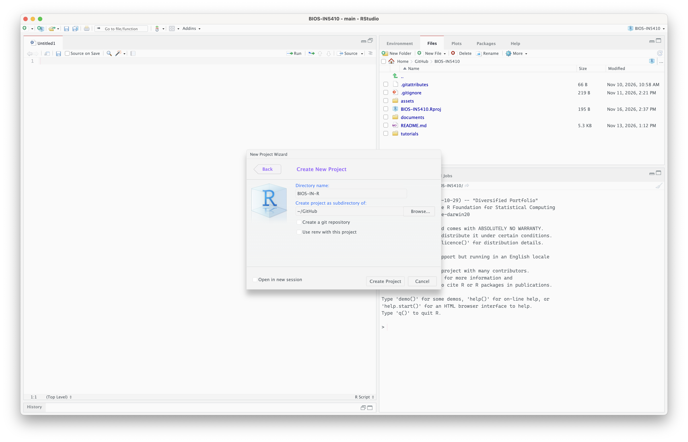
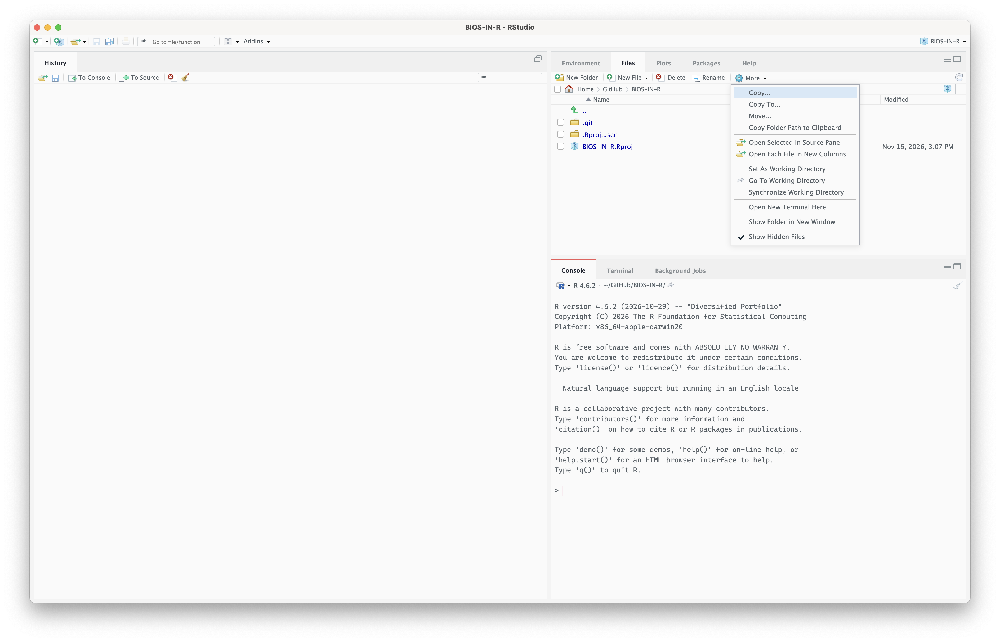
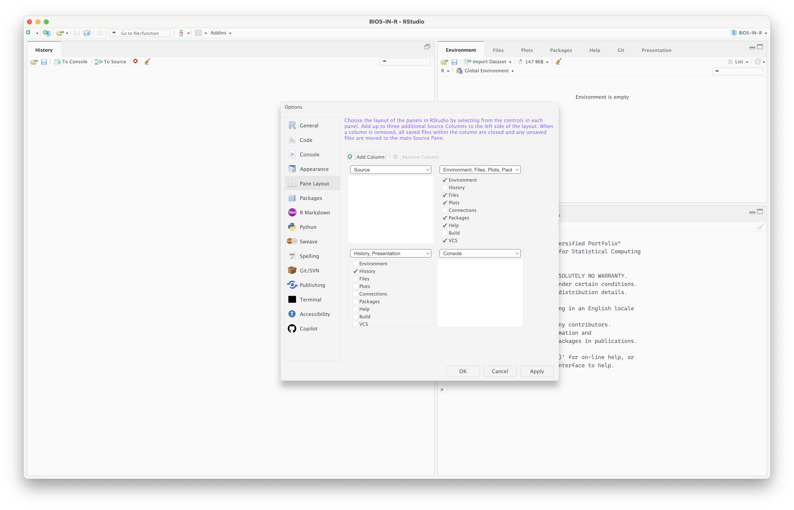
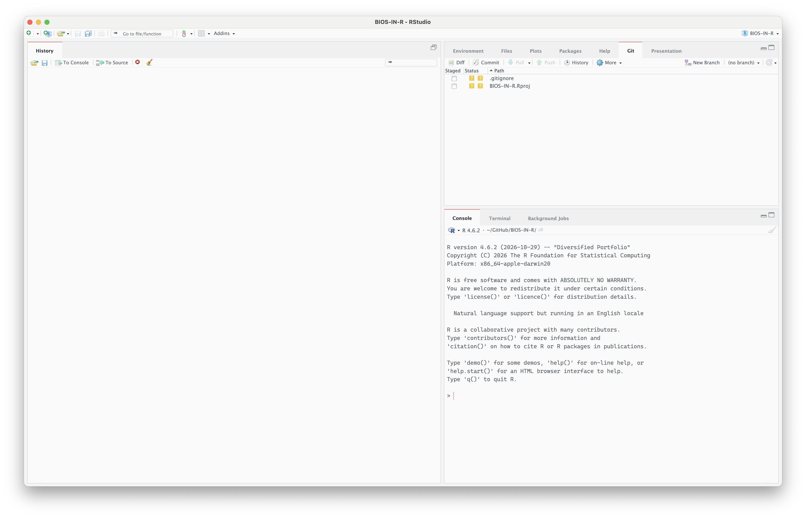
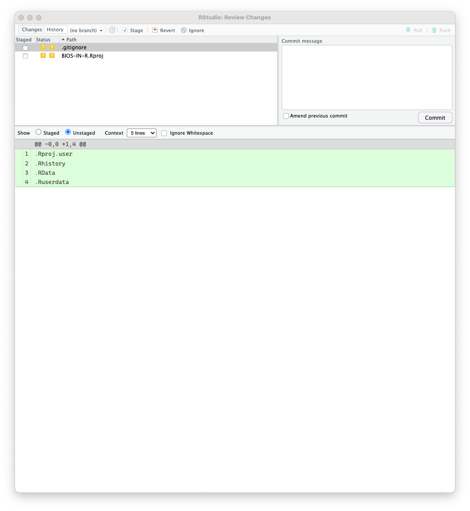
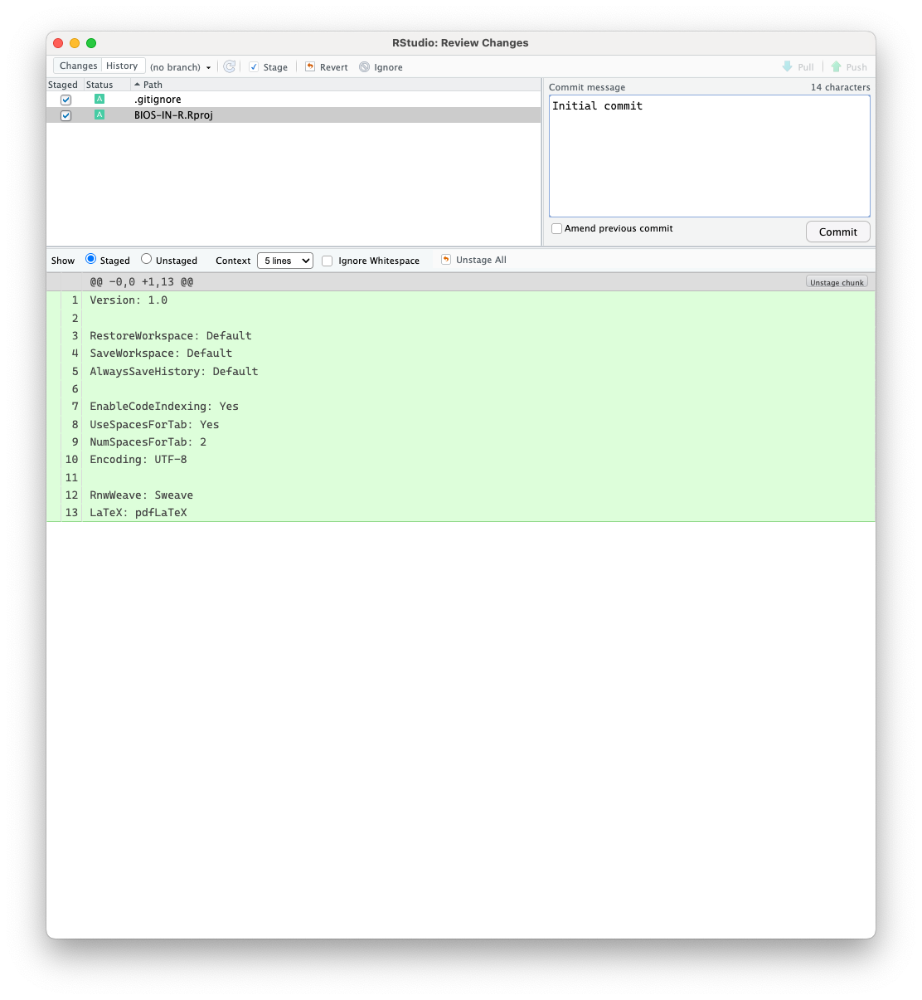
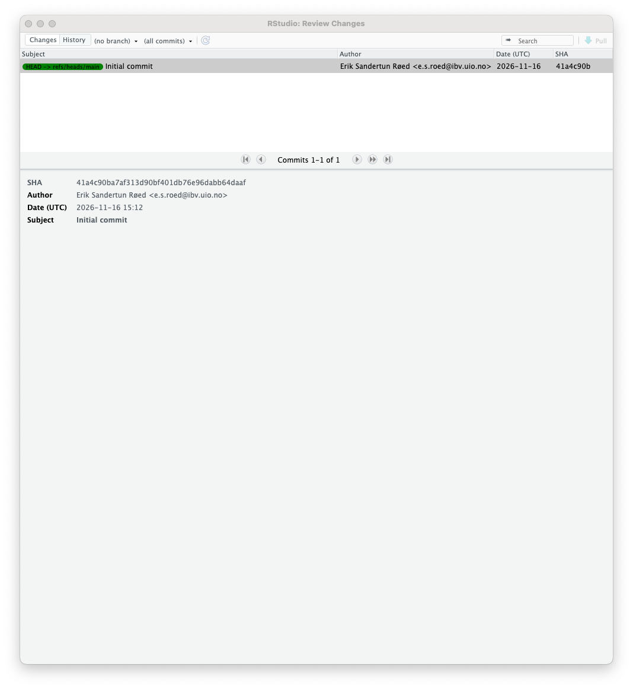
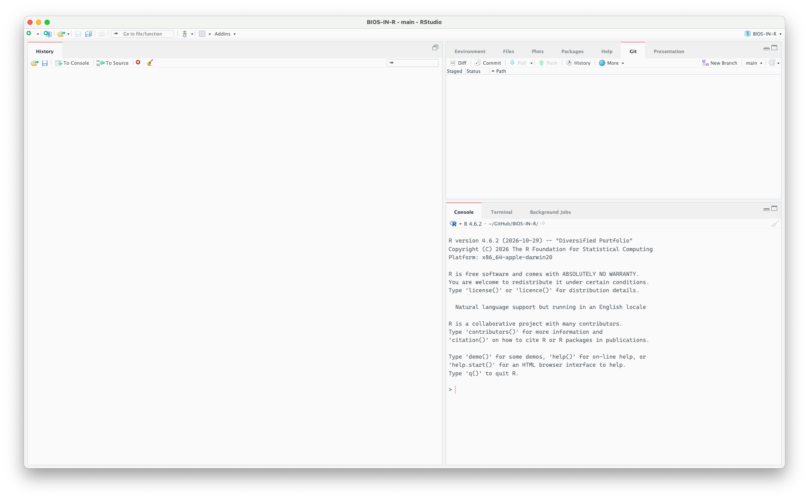
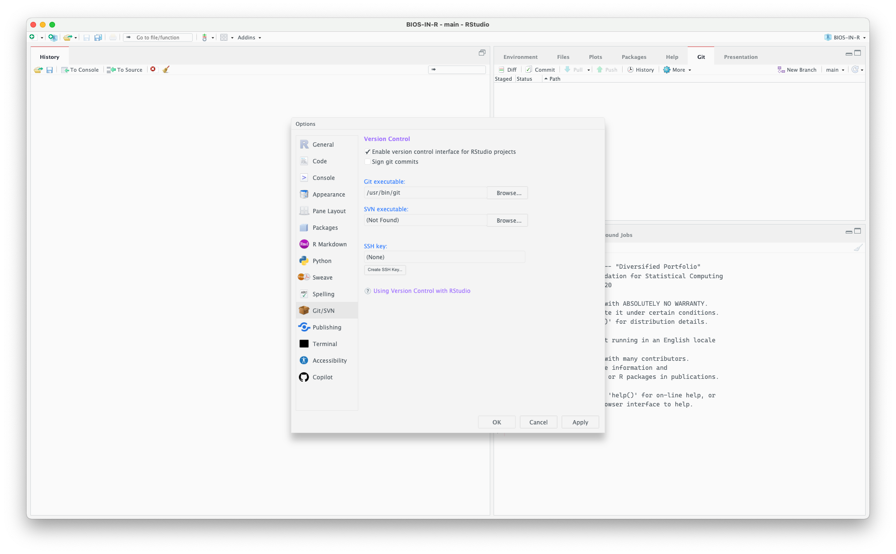

# Reproducible R

We are going to work reproducibly with R by using git for version control and GitHub for sharing, like you have learned. We will also use a feature of RStudio, RStudio projects, to enable even more handy features within RStudio.

## 1: Make an RStudio project

Open RStudio and click the projects menu:



Create a new project and select the "New Directory" option in the New Project Wizard window that opens. Under project type, simply select "New project", the top option. Give your project a meaningful name (you choose!). You do *not* have to tick the "Create a git repository" box:



Then click "Create project". RStudio will reopen with this project active: this means that RStudio will behave a little like git. It will focus on this one directory and the files inside it. This means you will work inside one directory only (like with git), which makes reproducibility possible because you ensure all required files are in one place.

## 2: Initialising our git repository
Now we are going to initialise a git repository. Open a terminal in RStudio (Tools -> New Terminal) and type `git init` (if at this stage you realise you do not have a local installation of git, install it yourself or ask for help). If you open the Files tab and check "Show hidden files" under "More" (see screenshot), you can now see we have initialised our Git repository:



We can also show a Git graphical user interface within RStudio. Restart RStudio (and open the project again), then open the "Pane Layout" options under "View" -> "Panes" -> "Pane Layout":



Check "VCS" (short for "Version Control System") in a pane you like (the top right pane usually works well). Then RStudio will show us the git status of our project / repository:



If you click on "Diff" you will open the window below. Recognise these features from Git on the command line?



Let's stage and commit these changes that already exist in our repository. They are the .RProj file (which was made automatically when we made the R Project) and .gitignore (which is made automatically when we initialise the git repo):



Once we click "Commit", a new "main" branch is made and the initial commit is done. You can see it in the history tab:



Can we push this to GitHub like we've done from Fox? ... well. You'll notice the "Pull" and "Push" buttons are greyed out in the "Git" pane:



Let's do something about that.

## 3: Linking this repository to GitHub
You are now working locally, not on Fox. So to authenticate to GitHub for pushing requires re-doing some steps you have previously done only on the command line. RStudio can make the SSH key for us, and the rest we do with the git commands you already know. You'll notice that this is repetition from a few days ago. To be transparent about it, this is the point: repetition is how we learn.

The commands below are typed in the RStudio Terminal (Tools -> Terminal -> New Terminal), *not* in the R Console. Note that this has to be a bash terminal (zsh is fine on Mac), so if you are on Windows: use the gitbash terminal which you should have installed previously.

### 3.1: Tell git who you are (if you've not already)
Git labels every commit with a name and an email. If you have not already configured git locally, you must do so. Check if you have configured your `user.name` and `user.email`:

```sh
git config --global --list
```

If not, configure these. Use the email address connected to your GitHub account (**type your own, do not copy and paste**):

```bash
git config --global user.name "Your Name"
git config --global user.email "your.email@example.com"
```

Finally check that it worked by running this again:

```bash
git config --global --list
```

### 3.2: Make an SSH key from inside RStudio
Like we authenticated our connection to GitHub on Fox, we have to authenticate our local machines. We will do this with an SSH key here, too. An SSH key is a pair of files: a *private* key that stays on your laptop, and a *public* key that you give to GitHub. When they match, GitHub lets you push without typing a password.

Go to "Tools" -> "Global Options..." -> "Git/SVN":



Note at the bottom the SSH key section. If the "SSH key" field says "(None)", click **"Create SSH Key..."**.

In the dialog that opens:

- Choose key type **ED25519** (or RSA if ED25519 is not offered: both work).
- You may leave the passphrase fields empty. A passphrase is more secure, but then you must type it when you push.
- Click "Create".

RStudio writes the key into a hidden `.ssh` folder in your home directory. You can see both halves of it from the Terminal:

```bash
ls ~/.ssh
```

### 3.3: Give the public key to GitHub
Still in "Tools" -> "Global Options..." -> "Git/SVN", click **"View public key"**. RStudio shows a long line starting with `ssh-ed25519` (or `ssh-rsa`). Copy all of it (Ctrl/Cmd + C).

(The same text is in the `.pub` file, so `cat ~/.ssh/id_ed25519.pub` in the Terminal works too.)

Then in your browser:

1. Go to [github.com/settings/keys](https://github.com/settings/keys).
2. Click "New SSH key".
3. Title: something you will recognise, e.g. "My laptop".
4. Key type: "Authentication Key".
5. Paste the public key into the "Key" box and click "Add SSH key".

Your private key must **never** leave your machine: only the public half is pasted here.

Test the connection from the Terminal:

```bash
ssh -T git@github.com
```

The first time you might be asked "Are you sure you want to continue connecting?": answer `yes`. GitHub then greets you by your username and tells you that shell access is not provided. That message means the key works.

### 3.4: Create the GitHub repository and push
Again these instructions are the same as you have done [previously](https://bios-in5410.github.io/Repr_Bioinfo/day3.html). Go to [github.com/new](https://github.com/new) and create a repository with the same name as your RStudio project. Do **not** add a README, a .gitignore or a licence: the repository must be empty, because we already have commits locally.

Copy the **SSH** URL from the green "Code" button (it starts with `git@github.com:`), then in the Terminal:

```bash
git remote add origin git@github.com:YOUR-USERNAME/YOUR-REPOSITORY.git
git branch -M main
git push -u origin main
```

Here `git remote add origin` tells your local repository where its GitHub copy lives, `git branch -M main` makes sure your branch is called `main` (the same name GitHub uses), and `-u` links your local `main` to `main` on GitHub so that later a plain `git push` is enough.

Check that it worked:

```bash
git remote -v
git status
```

Refresh your repository page on GitHub: your files should be there.

## You are now ready for some reproducible R
Open the Git pane again. The "Push" (up arrow) and "Pull" (down arrow) buttons are no longer greyed out, because your repository now has a remote. Your R workflow can now stay inside RStudio:

1. Edit your files and save them.
2. Tick the files you want in the Git pane ("Staged" column).
3. Click "Commit", write a meaningful message, click "Commit".
4. Click "Pull" to collect any changes from GitHub, then "Push" to send yours.

If you have experience from another IDE, like VS Code, you are free to use it if you can manage version control etc. on your own. However, you will be expected later in the course to use RStudio, so you must be comfortable with how it works.
