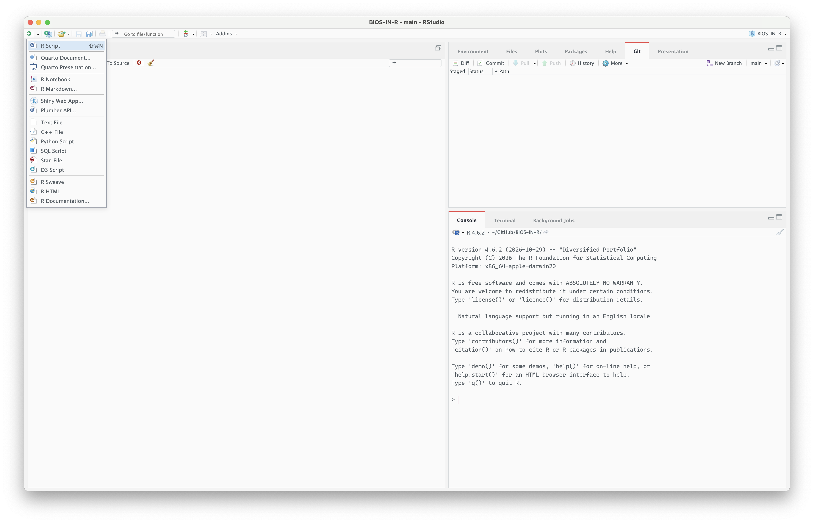
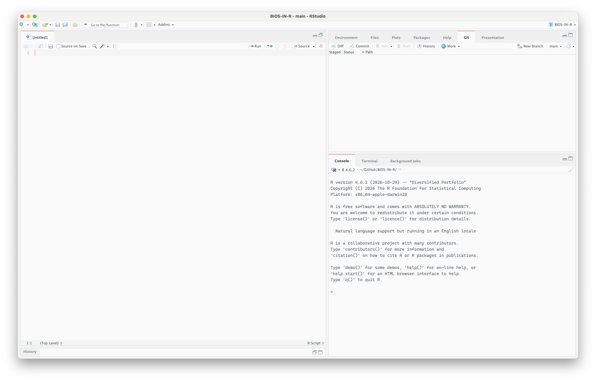
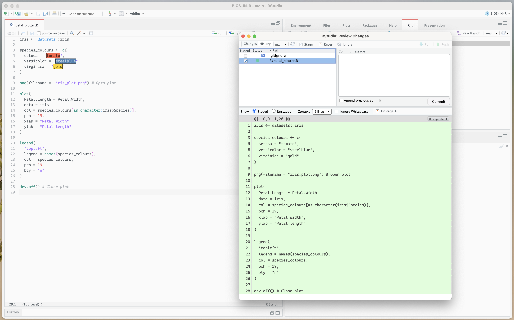
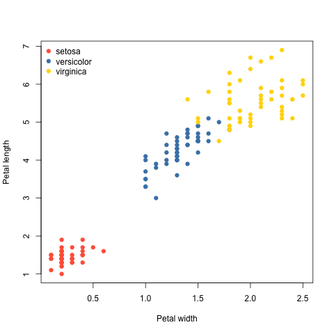
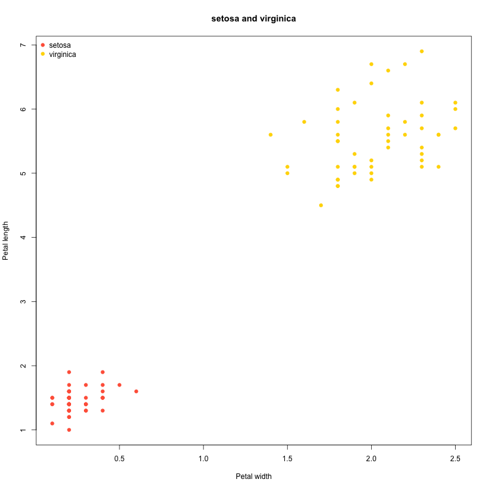
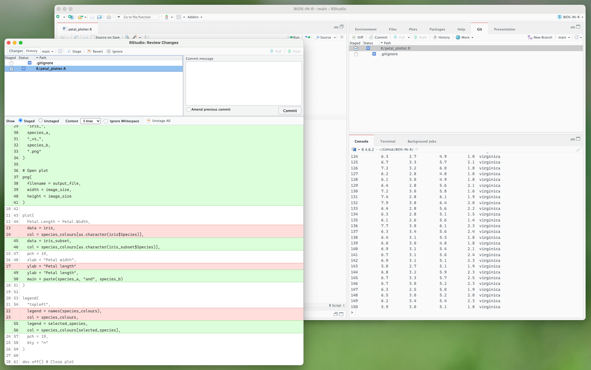

# Scripts in R

## Can I use language models to solve this exercise?
Can I stop you? No, not really! And I won't argue if you insist, anyways. But here's my recommendation: write the code here on your own or with the help of your peers. We'll use LLMs shamelessly in the next part of the module, but the code you need to write here is just fundamentals that you will benefit from knowing (and should recognise from the previous R session).

## 1: Making an R script
This will be familiar to many of you, but it is worth spelling out. R is a programming language. Often R is used as an interactive statistical software on the console, running line by line of code, but this is _very_ bad practice because interactive use is inherently irreproducible. Every task you perform with R should be specified in a reproducible .R file (or files). Better yet, the .R files should require no user interaction outside  running the script from the terminal (with documented inputs if applicable). By the end of BIOS-IN5410/9410 this will hopefully be a bit closer to second nature for you: do not despair if the idea is unfamiliar, that means you're learning something new!

To make an R script in RStudio, click the "New file" menu and select "R script" (or press Shift + Cmd / Ctrl + N):



This opens a new script file (by default new files are called "Untitled1", "Untitled2", etc):



Let's write a simple script to get the idea across. You'll write your own later; don't worry about understanding this one right now (this is an exercise below). For now copy-paste this script (using the copy button in the top right corner of the code box):
```R
iris <- datasets::iris

species_colours <- c(
  setosa = "tomato",
  versicolor = "steelblue",
  virginica = "gold"
)

png(filename = "iris_plot.png") # Open plot

plot(
  Petal.Length ~ Petal.Width,
  data = iris,
  col = species_colours[as.character(iris$Species)],
  pch = 19,
  xlab = "Petal width",
  ylab = "Petal length"
)

legend(
  "topleft",
  legend = names(species_colours),
  col = species_colours,
  pch = 19,
  bty = "n"
)

dev.off() # Close plot
```

For a bit of context: the `iris` dataset is a built-in R dataset with flower measurements from three different species of iris, _setosa_, _versicolor_, and _virginica_. It looks like this ...

```
> iris
    Sepal.Length Sepal.Width Petal.Length Petal.Width    Species
1            5.1         3.5          1.4         0.2     setosa
2            4.9         3.0          1.4         0.2     setosa
3            4.7         3.2          1.3         0.2     setosa
4            4.6         3.1          1.5         0.2     setosa
5            5.0         3.6          1.4         0.2     setosa
6            5.4         3.9          1.7         0.4     setosa
7            4.6         3.4          1.4         0.3     setosa
8            5.0         3.4          1.5         0.2     setosa
9            4.4         2.9          1.4         0.2     setosa
10           4.9         3.1          1.5         0.1     setosa
11           5.4         3.7          1.5         0.2     setosa
12           4.8         3.4          1.6         0.2     setosa
13           4.8         3.0          1.4         0.1     setosa
14           4.3         3.0          1.1         0.1     setosa
15           5.8         4.0          1.2         0.2     setosa
...
```

Make a subdirectory `R/` in your R project repository and save the script there as `petal_plotter.R`. When you have done this, you can commit the new script to git:



Really it would be best practice to make the commit after checking that the script works ... take my word for it for now, and we'll run it later.

### Exercise
Line by line, what does this script do? Can you read it on your own? Can you get a helpful answer from a language model? Figure this out (or make a good guess!) alongside the others at your table before running it below.

## 2: Running an R script
When we have saved a script as a `.R` file, we can run it from the command line by invoking the command `Rscript`. From within the project / repository directory, run the following on the Terminal (not the R Console):
```sh
Rscript R/petal_plotter.R
```
In the repository directory, you will observe that the script has produced an output file, `iris_plot.png`:



Because the script ran self-contained from the command-line without user intervention in the code itself, this script is reproducible. In this case the dataset is built-in, so you didn't have to bundle data with it. Someone can download your repository and run this script with exactly the same output as you!

## 3: Scripts with command-line arguments
It's all well and good to produce exactly the same output as somebody else from the same data. But what if you want to run a comparable analysis using variable settings? We can write our scripts to permit user-set options, or "command line arguments". Let's say we want to make a version of `petal_plotter.R` where we can select two species to plot and the width and height of the output plot in pixels. It should run something like this:
```sh
Rscript R/petal_plotter.R setosa virginica 800
```

We can handle the command line arguments with the `commandArgs` function, as shown in the below script. If we use `args <- commandArgs(trailingOnly = TRUE)`, the text we write after the plot path is accessible as the items of `args`: `args[1]` is the first, `args[2]` the second, and `args[3]` the third.

Below is a half-done version of the script that takes command-line arguments. As an exercise, complete it where the comments say "EXERCISE". If there are parts of this script you are not sure what do: ask someone at the table, or ask for help. Or can you prompt a language model to explain?

```R
# Read command-line arguments
args <- commandArgs(trailingOnly = TRUE)
species_a <- args[1] # The first argument is the name of the first species

# EXERCISE: Store the second arguments as species_b.
#
# species_b <- ...

# EXERCISE: Convert the third argument to an integer and store it as image_size.
#
# image_size <- as.integer(...)

# EXERCISE: Put species_a and species_b into one vector called selected_species.
#
# selected_species <- ...

iris_data <- datasets::iris

species_colours <- c(
  setosa = "tomato",
  versicolor = "steelblue",
  virginica = "gold"
)

# Keep only data from the selected species
iris_subset <- iris_data[iris_data$Species %in% selected_species, ]

# EXERCISE: Create an output filename using species_a and species_b.
#
# Example: "iris_setosa_vs_versicolor.png"
#
# output_file <- paste0(
#   "iris_",
#   species_a,
#   "_vs_",
#   species_b,
#   ".png"
# )

# Open plot
png(
  filename = output_file,
  width = image_size,
  height = image_size
)

plot(
  Petal.Length ~ Petal.Width,
  data = iris_subset,
  col = species_colours[as.character(iris_subset$Species)],
  pch = 19,
  xlab = "Petal width",
  ylab = "Petal length",
  main = paste(species_a, "and", species_b)
)

legend(
  "topleft",
  legend = selected_species,
  col = species_colours[selected_species],
  pch = 19,
  bty = "n"
)

dev.off() # Close plot
```

When you have completed your updates, try running the script with some settings of your choice, e.g.:
```sh
Rscript R/petal_plotter.R setosa virginica 800
```

You should get something like this ...



If it works, you can commit your changes. You will now see the diff between the original script and your updates in the git diff window in RStudio:



## Summary: what you should now be able to do
Having worked through this document, you should be able to:

1. **Create and organise an R script.** Make a new R script in RStudio, store it in a sensible place in your project (such as an `R/` subdirectory), and give it a descriptive filename like `petal_plotter.R`.
2. **Read a script before running it.** Work out line by line what an unfamiliar script does — including where it gets its data, what it computes, and what files it writes — using your own reading, your peers, and language models as support.
3. **Run a script from the command line.** Execute a script from the Terminal (not the R Console) with `RScript` and locate the output it produces in your project directory.
4. **Make a script configurable.** Capture user settings with `commandArgs(trailingOnly = TRUE)`, index them (`args[1]`, `args[2]`, ...), convert them to the right type (e.g. `as.integer`), and use them.
5. **Version-control your script with git in RStudio.** Commit R scripts and their changes to git in RStudio, ideally after checking that they run, and inspect the diff between versions in RStudio's git pane.
